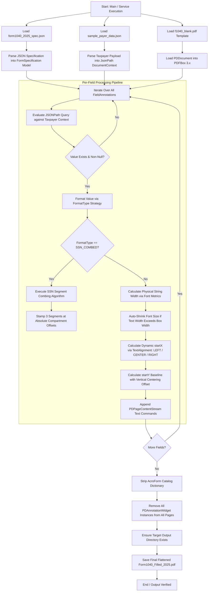
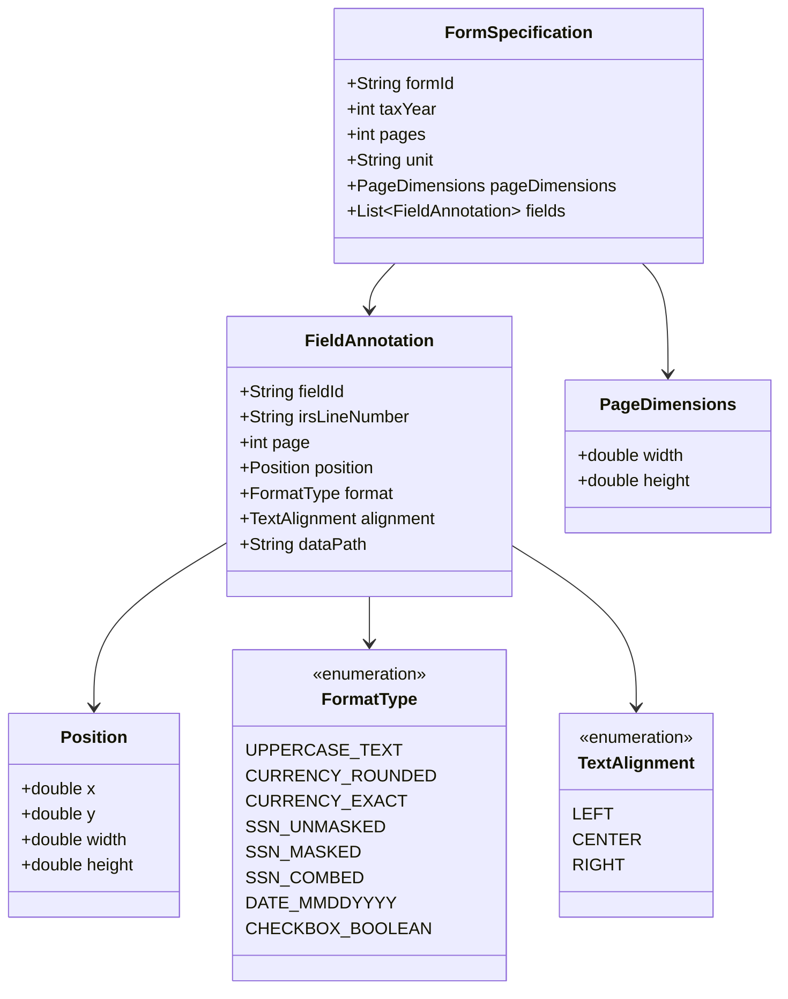
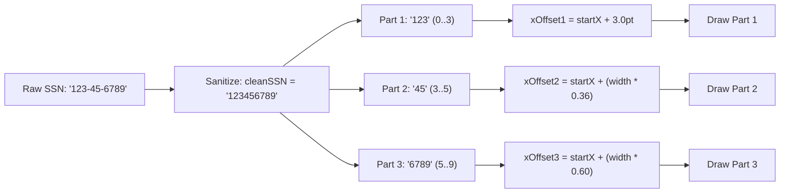
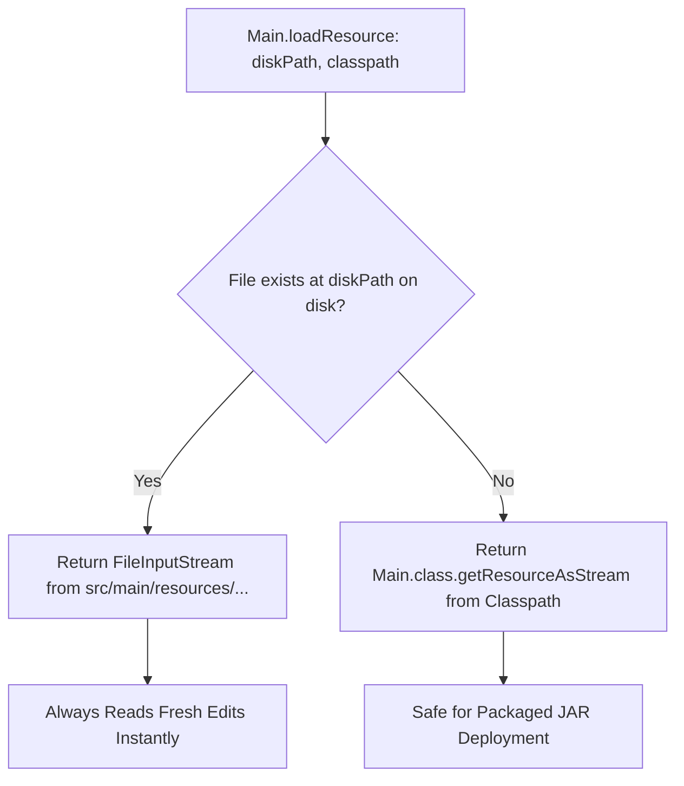

# IRS Form 1040 AI Overlay Engine - Architectural Specification & Technical Flow Guide

---

## 1. Executive Summary

### 1.1 The Problem
Automated tax preparation platforms (e.g., TurboTax, H&R Block, TaxSlayer) must generate official IRS tax returns that satisfy strict visual and structural requirements:
1. **OMR/OCR Scanner Compliance:** IRS high-speed optical mark recognition (OMR) scanners require text and numbers to sit within precise physical bounding boxes without overlapping borders.
2. **Fragility of AcroForms / XFA:** The official IRS Form 1040 PDF is created using Adobe LiveCycle Designer as an XFA-hybrid PDF. Field names are arbitrary (`topmostSubform[0].Page1[0].f1_01[0]`), interactive checkboxes default to cross (`X`) symbols, and filling them via standard AcroForm APIs often causes rendering bugs across third-party PDF viewers (Chrome, Safari Preview, mobile readers).
3. **Complex Structures:** Dashed-line comb boxes (e.g., Social Security Numbers) cannot be filled with a single continuous string without characters drifting across partition lines.

### 1.2 The Solution
This project implements a **100% coordinate-based 2D canvas overlay engine** in Java 17 using Apache PDFBox 3.x:
* **Bypasses AcroForms completely:** Stamps vector text and glyphs directly onto the raw PDF page content stream.
* **Declarative Specification:** Decouples field coordinates and formatting rules into an external, near-immutable JSON specification (`form1040_2025_spec.json`).
* **Algorithmic Combing:** Automatically segments SSNs and centers digits into individual IRS compartment boxes.
* **Automatic Widget Stripping & Flattening:** Purges all legacy interactive widget annotations, producing a flat, print-ready, tamper-proof archival PDF where checkmarks always render as true tick marks (`✓`).

---

## 2. System Architecture & High-Level Flow

### 2.1 Complete Processing Flowchart



---

## 3. Data Flow & Component Breakdown

### 3.1 Input Artifacts
| Artifact | Location | Responsibility |
| :--- | :--- | :--- |
| **`f1040_blank.pdf`** | `src/main/resources/` | Official blank IRS Form 1040 template (2 pages, 612 x 792 pt). |
| **`form1040_2025_spec.json`** | `src/main/resources/specs/` | Static JSON containing physical coordinates, JSONPath bindings, alignments, and format types for 74+ fields. |
| **`sample_payer_data.json`** | `src/main/resources/` | Dynamic taxpayer tax return payload (taxpayer, spouse, dependents, income, tax, payments). |

### 3.2 Core Java Domain Models (`com.taxapp.model`)



---

## 4. Key Algorithms & Implementation Details

### 4.1 Coordinate System & Geometry
* **PDF Canvas Space:** Standard PDF coordinate space has its origin `(0, 0)` at the **lower-left corner** of the page.
* **Dimensions:** Standard US Letter is `612.0 pt` wide by `792.0 pt` high (72 points = 1 inch).
* **Baseline Offset (`startY`):**
  * When drawing text via `stream.newLineAtOffset(x, y)`, `y` specifies the font's **baseline**, not the bottom of the bounding box.
  * Standard text offset: `startY = position.y + 2.5f` (centers 8.5pt text within a 12-14pt box).
  * Checkbox offset: `startY = position.y + 1.0f` (centers the 8.5pt ZapfDingbats checkmark glyph).

```
  +-----------------------------------------------------------+ (x + width, y + height)
  |                                                           |
  |   Text Glyphs Sit Above Baseline                          |
  |  -------------------------------------------------------  | <--- y + 2.5pt (Baseline)
  +-----------------------------------------------------------+ (x, y)
```

---

### 4.2 Horizontal Alignment Math
Before stamping, the physical string width is calculated in PDF points:
$$\text{textWidth} = \left(\frac{\text{font.getStringWidth(text)}}{1000.0}\right) \times \text{fontSize}$$

The starting horizontal point (`startX`) is dynamically calculated:
* **LEFT Alignment:**
  $$\text{startX} = \text{position.x} + 2.0\text{ pt (padding)}$$
* **CENTER Alignment (Checkboxes & Centered Fields):**
  $$\text{startX} = \text{position.x} + \frac{\text{position.width} - \text{textWidth}}{2}$$
* **RIGHT Alignment (Currency / Amounts):**
  $$\text{startX} = (\text{position.x} + \text{position.width}) - \text{textWidth} - 2.0\text{ pt (padding)}$$

---

### 4.3 Adaptive Font Auto-Shrinking
To prevent long text strings (e.g., long employer names or large dollar figures) from colliding with box borders or overflowing:
```java
if (field.format() != FormatType.CHECKBOX_BOOLEAN && field.position().width() > 10.0) {
    float maxAllowedWidth = (float) (field.position().width() - 4.0);
    while (fontSize > 5.5f && (selectedFont.getStringWidth(cleanValue) / 1000.0f) * fontSize > maxAllowedWidth) {
        fontSize -= 0.5f;
    }
}
```

---

### 4.4 SSN Segment Combing Algorithm (`SSN_COMBED`)
IRS SSN boxes feature dashed visual vertical lines dividing the box into 3 compartments:
* **Compartment 1:** 3 digits (Area number) $\rightarrow$ spans $0\%$ to $33.2\%$ of box width.
* **Compartment 2:** 2 digits (Group number) $\rightarrow$ spans $33.2\%$ to $56.0\%$ of box width.
* **Compartment 3:** 4 digits (Serial number) $\rightarrow$ spans $56.0\%$ to $100\%$ of box width.



This guarantees that whether rendering the Taxpayer SSN in the header ($w = 107.0$) or Dependents 1, 2, 3 across columns ($w = 106.25$), every digit is positioned cleanly within its partition.

---

### 4.5 Formatting Strategy Matrix (`extractAndFormat`)

| `FormatType` | Input Example | Output Example | Technical Transformation |
| :--- | :--- | :--- | :--- |
| `UPPERCASE_TEXT` | `"Jane Doe"` | `"JANE DOE"` | `.toString().toUpperCase().trim()` |
| `CURRENCY_ROUNDED`| `115000.50` | `"115001"` | `Math.round(num.doubleValue())` (IRS nearest whole dollar) |
| `CURRENCY_EXACT` | `4320.75` | `"4320.75"` | `String.format("%.2f", num)` (exact dollars and cents) |
| `CHECKBOX_BOOLEAN`| `true` | `"\u2713"` | ZapfDingbats byte `0x33` vector checkmark |
| `SSN_COMBED` | `"987-65-4321"` | `"987654321"` | Strips all non-digits, parsed by combing renderer |
| `SSN_MASKED` | `"999-88-7766"` | `"XXXXX7766"` | Preserves last 4 digits, masks leading 5 |
| `DATE_MMDDYYYY` | `"2026-04-15"` | `"04/15/2026"` | Parses ISO `YYYY-MM-DD` or standard strings to `MM/DD/YYYY` |

---

## 5. Form Flattening & Anti-Widget Protection

### 5.1 Why Adobe Acrobat Displayed a Cross (`X`)
1. **IRS Specification Standard:** The IRS designs forms in Adobe LiveCycle Designer. Per official instructions (*"enter an X in the box"*), IRS OMR scanning hardware was built to recognize an `X` connecting 4 corners rather than asymmetric checkmarks.
2. **Interactive Widget Overlay:** Interactive PDF viewers (Adobe Reader, Chrome) maintain an annotation widget layer *above* the visual canvas. When a user manually clicked a checkbox widget, Acrobat triggered its default interactive style (`Cross`).

### 5.2 The Flattening Solution
To make the document truly flat and prevent interactive widget interference, the engine purges the AcroForm catalog and strips all widget annotations:
```java
// Completely strip leftover interactive form widgets from the template
document.getDocumentCatalog().getCOSObject().removeItem(COSName.ACRO_FORM);
for (PDPage p : document.getPages()) {
    List<PDAnnotation> annots = new ArrayList<>();
    for (PDAnnotation annot : p.getAnnotations()) {
        if (!(annot instanceof PDAnnotationWidget)) {
            annots.add(annot);
        }
    }
    p.setAnnotations(annots);
}
```
**Outcome:** The generated PDF is 100% flat. No interactive form highlights exist, and checkmarks (`✓`) remain permanent and unalterable.

---

## 6. Live Developer Reloading

When developing and testing tax payloads locally, recompiling via Maven after every JSON change introduces unnecessary friction. [Main.java](file:///c:/Self%20Learning/AnnotationProject/src/main/java/com/taxapp/Main.java) implements a **filesystem-first resource resolution strategy**:



---

## 7. Automated Testing & Verification Pipeline

The project includes 9 automated tests across two suites:

1. **`Form1040FillerServiceTest`**
   * Verifies specification loading and page dimension checks.
   * Tests formatting transformations across all `FormatType` values.
   * Performs end-to-end PDF generation and runs `PDFTextStripper` assertions verifying:
     * Taxpayer name (`ROHIN SELVA`)
     * Rounded currency (`115001`) vs Exact currency (`4320.75`)
     * Combed SSNs for Taxpayer and 3 Dependents
     * Masked former spouse SSN (`XXXXX7766`)
     * Signature date (`04/15/2026`)
     * Ensures hyphenated SSNs (`123-45-6789`) are never leaked onto the canvas.
2. **`CoordinateCalibratorTest`**
   * Renders 300 DPI high-resolution crops of header SSNs, comb boxes, multi-column dependents, checkboxes, and signature blocks for visual QA.
